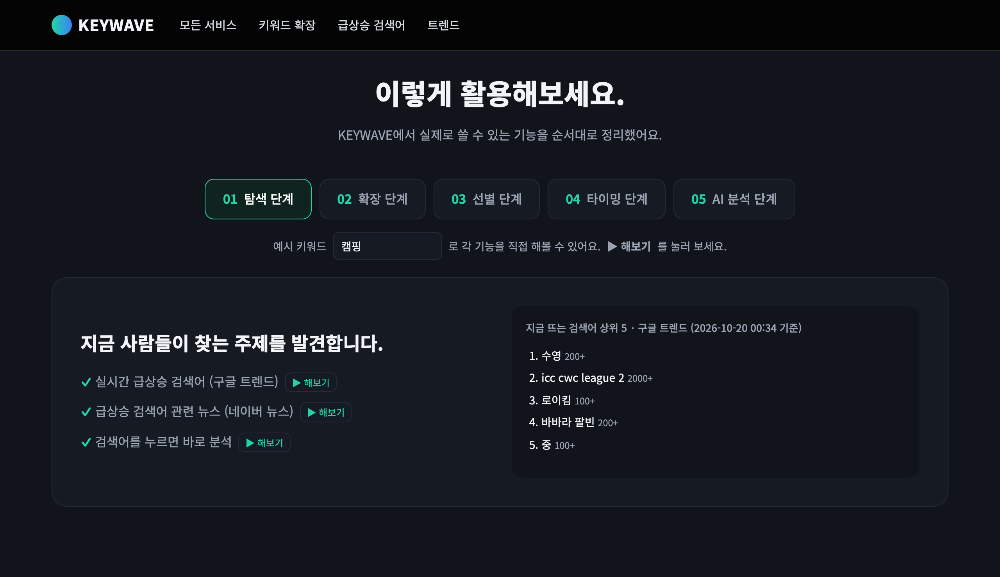
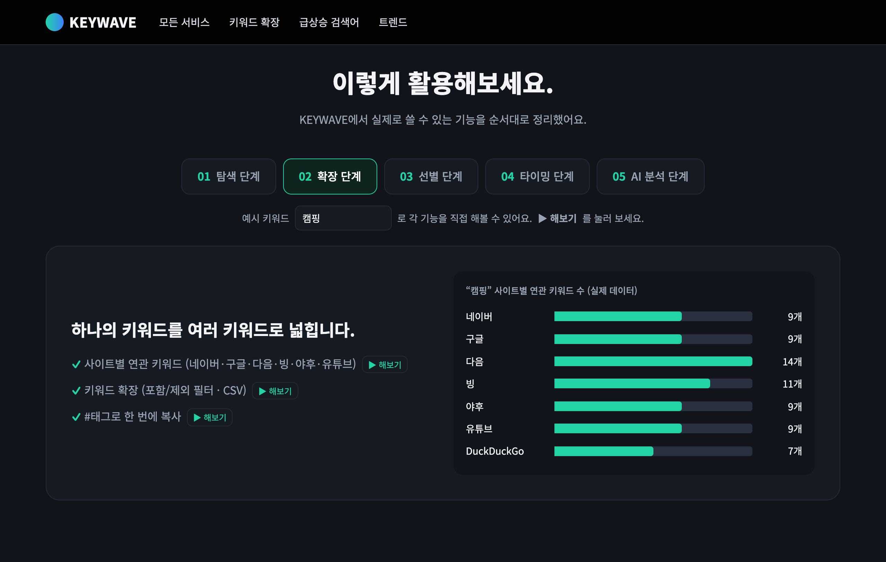
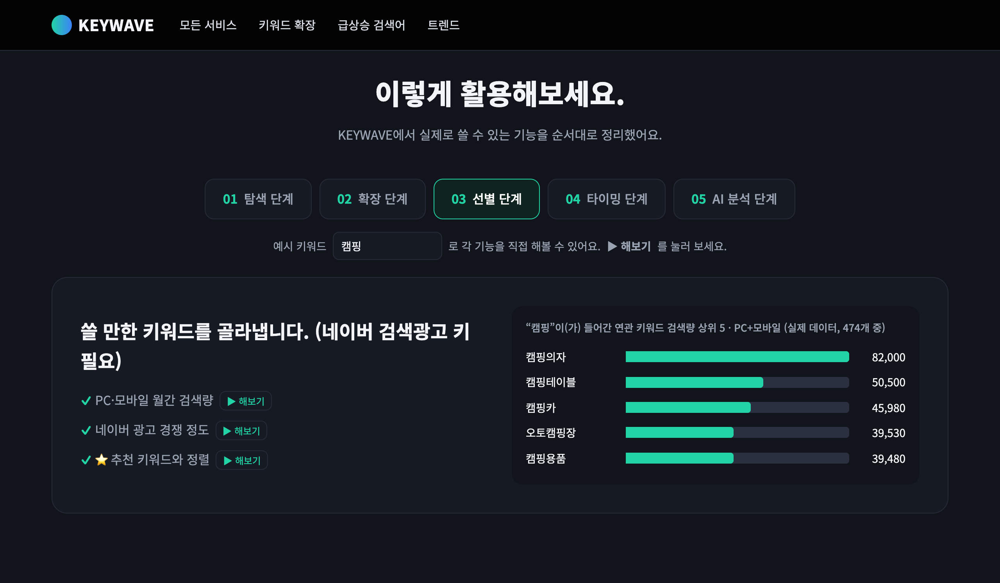
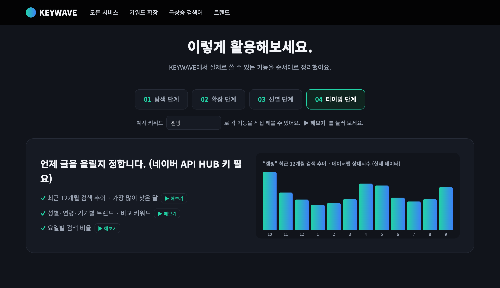
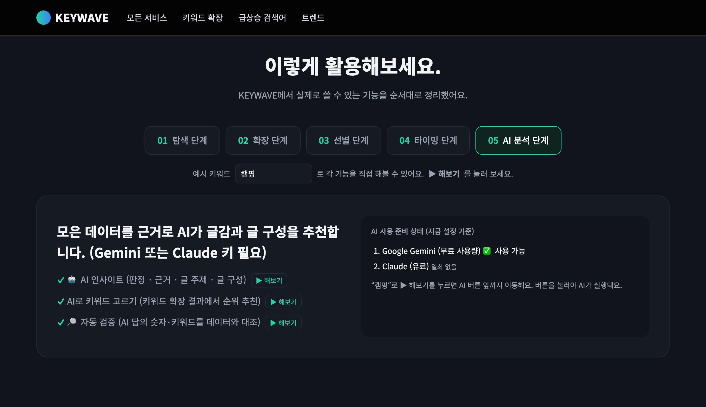

# KEYWAVE

AI 시대의 검색 마케팅을 위한, 믿을 수 있는 키워드 분석 툴입니다.
AI 추천을 실제 네이버 데이터와 자동으로 대조해, 숫자로 확인된 키워드와 콘텐츠 주제만 골라 줍니다.

네이버 검색량·광고 경쟁·12개월 추이, 사이트별 연관 키워드, 실시간 급상승 검색어를 한곳에서 보고
🤖 AI 인사이트로 글로 쓸 콘텐츠 주제까지 추천받습니다.

- 주소: <http://localhost:8765>
- 활용 방법(워크플로): <http://localhost:8765/#workflow>

---

## 실행 방법

1. `KEYWAVE 켜기.command`를 더블클릭합니다. 서버가 켜지고 브라우저가 자동으로 열립니다.
   (이미 켜져 있으면 브라우저만 엽니다. 끄려면 터미널 창을 닫으세요.)
2. 또는 터미널에서 직접 실행합니다.

```bash
python3 server.py
```

- `.venv`가 있으면 그 파이썬을 씁니다(AI 인사이트용 패키지 포함).
- 포트는 기본 `8765`이고, 환경변수 `PORT`로 바꿀 수 있습니다.

## 인터넷에 올리기 (Render)

내 컴퓨터에서 켜는 KEYWAVE(`localhost`)는 컴퓨터를 끄면 같이 꺼집니다.
[Render](https://render.com)에 올리면 컴퓨터가 꺼져 있어도 휴대폰·다른 컴퓨터에서 `https://….onrender.com` 주소로 열립니다.
저장소에 들어 있는 `render.yaml`이 설정을 대신 해 줍니다.

1. render.com에 **GitHub 계정으로 가입**합니다.
2. 대시보드 → **New → Blueprint** → 저장소 `guhakim/keywave`를 고릅니다.
3. Render가 아래 값을 물어봅니다. 비어 있는 칸은 그냥 두면 됩니다.
   - `KEYWAVE_PASSWORD`: 사이트에 들어갈 때 쓸 **비밀번호를 새로 정해서** 넣으세요. (로그인 창의 아이디 칸은 아무거나)
   - `NAVER_AD_*`, `NAVER_HUB_*`, `GEMINI_API_KEY`, `ANTHROPIC_API_KEY`: 내 컴퓨터 `.env`에 있는 값을 그대로 넣으세요.
4. **Apply**를 누르면 몇 분 뒤 주소가 생깁니다.

알아 둘 점
- **무료 요금제**는 15분 동안 아무도 안 쓰면 잠들고, 다음에 열 때 깨어나는 데 1분쯤 걸립니다.
- 열쇠는 Render의 **Environment**에서만 넣고 바꿉니다. 인터넷에 올린 KEYWAVE에서는 🔑 열쇠 넣기 화면이 저장을 막습니다.
- `KEYWAVE_PASSWORD`를 비워 두면 주소를 아는 누구나 들어와 내 네이버·Gemini 사용량을 쓸 수 있으니 꼭 넣으세요.
- Render 서버는 싱가포르에 있어서, 자동완성 결과가 한국에서 볼 때와 조금 다를 수 있습니다.
- GitHub `main`에 올릴 때마다 Render가 자동으로 새로 배포합니다.

## 열쇠(API 키) 넣기

<http://localhost:8765/setup.html>에서 붙여넣으면 같은 폴더의 `.env`에 저장됩니다.
직접 넣으려면 `.env.example`을 `.env`로 복사한 뒤 값을 채우세요. 비어 있는 칸은 그냥 두면 됩니다.

| 순서 | 서비스 | 필수 여부 | 쓰이는 곳 |
|---|---|---|---|
| ① | 네이버 검색광고 (`NAVER_AD_*`) | **필수** | 월간 검색량 · 연관 키워드 · 광고 경쟁 정도 |
| ② | NAVER API HUB (`NAVER_HUB_*`) | 선택 | 블로그 발행량 · 12개월 그래프 · 성별/연령/기기/요일 트렌드 |
| ③ | Google Gemini (`GEMINI_API_KEY`) | 선택 | 🤖 AI 인사이트 (무료 사용량 있음) |
| ④ | Claude API (`ANTHROPIC_API_KEY`) | 선택 | 🤖 AI 인사이트 (쓸 때마다 비용 발생) |

> 2026-07-31 이전에 네이버 개발자센터에서 받은 키가 있으면 `NAVER_CLIENT_ID` / `NAVER_CLIENT_SECRET`에 넣어도 됩니다.
> `.env`에는 비밀 키가 들어 있으니 다른 사람과 공유하지 마세요.

---

## 활용 방법 (워크플로) — `#workflow`

KEYWAVE에서 실제로 쓸 수 있는 기능을 순서대로 정리한 것입니다.
페이지의 **예시 키워드**(기본값 `캠핑`)를 바꾼 뒤 각 항목의 **▶ 해보기**를 누르면 그 기능이 실제로 실행되고 해당 위치로 이동합니다.
오른쪽 미리보기는 예시 키워드의 실제 데이터입니다.

> 아래 화면은 예시 키워드 `캠핑`으로 2026-10-19에 기록한 것입니다.

### 01 탐색 단계 — 지금 사람들이 찾는 주제를 발견합니다

- 실시간 급상승 검색어 (구글 트렌드)
- 급상승 검색어 관련 뉴스 (네이버 뉴스)
- 검색어를 누르면 바로 분석



### 02 확장 단계 — 하나의 키워드를 여러 키워드로 넓힙니다

- 사이트별 연관 키워드 (네이버·구글·다음·빙·야후·유튜브)
- 키워드 확장 (포함/제외 필터 · CSV)
- #태그로 한 번에 복사



### 03 선별 단계 — 쓸 만한 키워드를 골라냅니다 *(네이버 검색광고 키 필요)*

- PC·모바일 월간 검색량
- 네이버 광고 경쟁 정도
- ⭐추천 키워드와 정렬
- 연관 키워드는 **입력한 키워드가 들어간 것만, 검색량 순 위 20개**를 보여 줍니다 (예: `캠핑` → 1,199개 중 474개)



### 04 타이밍 단계 — 언제 글을 올릴지 정합니다 *(NAVER API HUB 키 필요)*

- 최근 12개월 검색 추이 · 가장 많이 찾은 달
- 성별·연령·기기별 트렌드 · 비교 키워드
- 요일별 검색 비율



### 05 AI 분석 단계 — 모은 데이터를 근거로 AI가 글 주제와 글 구성을 추천합니다 *(Gemini 또는 Claude 키 필요)*

- 🤖 AI 인사이트 (판정 · 근거 · 글 주제 · 글 구성)
- AI로 키워드 고르기 (키워드 확장 결과에서 순위 추천)
- 🔎 자동 검증 (AI 답의 숫자·키워드를 데이터와 대조)

AI는 쓸 때마다 비용(또는 무료 한도)이 들어서, **▶ 해보기**는 AI 버튼이 있는 곳까지만 이동합니다. 버튼을 눌러야 AI가 실행돼요.
오른쪽 미리보기에는 지금 쓸 수 있는 AI(Gemini · Claude)가 실제 설정 그대로 나옵니다.



### 한눈에 보기

```
탐색 (급상승 검색어) → 확장 (연관·자동완성 키워드) → 선별 (검색량·경쟁) → 타이밍 (12개월·요일 추이) → AI 분석 (판정·글 주제·글 구성) → 글 기획
```

---

## 주요 기능

### 키워드 확장
시드 키워드(한 줄에 하나, 최대 5개)를 넣으면 네이버 검색광고 연관 키워드와 7개 사이트 자동완성 키워드를 모두 모읍니다.

- **포함할 단어 / 제외할 단어**: 쉼표로 구분, 각각 최대 5개
- **고급 필터**: 월간 검색량 합계 범위, 광고 경쟁(낮음/중간/높음), 모바일 검색 비율(%), 광고 평균 클릭률(%)
  - 검색량이 없는 자동완성 키워드는 고급 필터를 쓰면 빠집니다.
  - `<10`(10 미만)이 섞인 키워드는 확실히 조건에 맞을 때만 남깁니다.
- **검색량 있는 것만** 보기, CSV 내려받기

### 🤖 AI로 키워드 고르기
지금 표에 보이는 순서대로 위쪽 최대 80개(검색량·광고 경쟁·블로그 글 수·글÷검색량)를 AI에게 보내 쓸 만한 키워드를 순위로 받습니다.
필터·정렬을 먼저 해 두면 더 좋습니다.
AI 답은 아래 **AI 답 자동 검증**을 거쳐서 화면에 나옵니다.

### 급상승 검색어 · 트렌드
지금 한국에서 검색이 급증한 키워드(구글 트렌드 RSS)와 관련 뉴스를 보여 줍니다.

---

## 데이터 정확성 (2026-10-19 점검)

`캠핑`으로 화면 값과 원본 API(네이버 검색광고 · NAVER API HUB · 각 사이트 자동완성 · 구글 트렌드)를 대조했습니다.
검색량·광고 경쟁·블로그 글 수·12개월 추이·사이트별 자동완성 수는 원본과 같았고,
`posts/`의 기획서 숫자(깍두기·LA갈비찜·전어)도 다시 조회한 값과 같았습니다 (블로그 글 수는 그사이 늘어난 만큼만 차이).
발견한 문제와 고친 내용은 아래와 같습니다.

| 문제 | 고친 내용 |
|---|---|
| 검색광고 연관 키워드 약 1,200개 중 **검색량과 상관없는 순서의 앞 20개**만 쓰면서 "상위"라고 표시 | 검색량 순으로 정렬하고, 전체·남은 개수를 화면에 표시 |
| 광고주 기준 연관이라 `보트박람회`, `워크자켓`, `추석` 같은 **주제와 먼 키워드**가 연관 키워드·#태그·AI 데이터에 섞임 | 입력한 키워드가 들어간 것만 남김 (띄어 쓴 키워드는 낱말이 모두 들어 있어야 함) |
| AI 답은 **모양만 확인**하고 내용은 확인하지 않았는데, 화면에는 "숫자는 KEYWAVE 데이터에서 왔다"고 표시 | **AI 답 자동 검증** 추가 (아래) |
| Gemini가 503(붐빔)이면 바로 실패 | `gemini-3.8-flash`를 5초 쉬고 한 번 더 묻고, 그래도 붐비면 `gemini-2.5-flash`로 자동 전환 (화면 아래에 "⚠️ …로 답했어요" 표시) |

### AI 답 자동 검증
AI 인사이트와 키워드 확장 AI 추천 모두, 서버가 AI 답을 AI에게 보낸 데이터와 하나하나 대조합니다.

- **숫자**: 답에 나온 숫자가 데이터에 없으면 ⚠️로 표시합니다. PC+모바일 합계, 모바일 비율(%), `1,590만`처럼 줄여 쓴 값은 원래 값과 맞으면 통과합니다. 12 이하 정수(월·개수)와 연도는 건너뜁니다.
- **키워드**: 데이터에 없는 키워드는 주제 묶음에서 빼고, 추천·글 주제에서는 "데이터에 없는 키워드"로 표시합니다.
- 결과는 화면의 **🔎 자동 검증** 상자에 모아 보여 줍니다. AI가 직접 계산한 배수·비율(예: "2.3배")도 데이터에 없는 숫자로 표시될 수 있습니다.
- 숫자와 키워드만 대조합니다. 문장의 해석이 맞는지(예: 비율을 거꾸로 설명)는 확인하지 못하니 직접 읽어 보세요.

### 남은 주의점
- `<10`(10 미만) 검색량은 정렬·⭐추천 계산에서 0으로 취급합니다. 이런 값이 섞인 합계는 `60+`처럼 `+`를 붙여 "최소값"임을 표시합니다.
- 연관 키워드 필터는 입력한 키워드가 **글자 그대로** 들어간 것만 남깁니다. 그래서 `깍두기`는 220개 중 3개만 남고, `석박지`·`무김치담그기`처럼 주제는 맞지만 글자가 다른 키워드도 빠집니다. 이런 키워드는 사이트별 자동완성이나 키워드 확장에서 찾아 주세요.
- 네이버 검색광고가 연관 키워드를 아예 주지 않는 키워드도 있습니다 (예: `갈비찜압력솥`). 이때는 화면에 그렇다고 표시합니다.
- 12개월 막대의 "약 N회"는 검색광고의 최근 30일 검색량을 데이터랩 비율로 환산한 **추정치**입니다.
- 급상승 검색어의 "기준" 시각은 서버가 가져온 시각이며 10분 동안 캐시합니다.
- 키워드 확장은 "모두 모으기"가 목적이라 연관성 필터를 넣지 않았습니다. 포함/제외 필터를 쓰세요.
- 전어 기획서의 노량진 경락가는 조회형 사이트라 자동으로 다시 확인하지 못했습니다.

---

## 폴더 구조

```
keywave/
├── KEYWAVE 켜기.command   # 더블클릭으로 서버 켜기
├── server.py              # 정적 파일 + 키워드 분석 API 서버
├── index.html             # 메인 화면 (키워드 분석 · 확장 · 활용 방법 · 트렌드)
├── setup.html             # 열쇠(API 키) 넣기 화면
├── .env.example           # 키 템플릿 (.env로 복사해서 사용)
├── requirements.txt       # 배포용 패키지 목록 (AI 인사이트 Claude용)
├── render.yaml            # Render에 올리는 설정 (열쇠 값은 들어 있지 않음)
├── docs/images/           # README용 워크플로 화면 기록
└── posts/                 # KEYWAVE 데이터로 기획한 블로그 글
    ├── kkakdugi/          # 기획서.md · 본문.html · cards.html · images/
    ├── la-galbijjim/      # 기획서.md · 본문.html · 쿠팡상품.html
    └── jeoneo/            # 기획서.md · 본문.html
```

### 글 작성 흐름 (`posts/`)
워크플로 5단계로 키워드를 고른 뒤, 글마다 폴더를 만들어 기록합니다.

1. `기획서.md` — 메인 키워드, 월간 검색량, 블로그 누적 글 수, 글÷검색량 등 데이터 근거와 글 구성
2. `본문.html` — 실제 블로그 본문
3. (선택) `cards.html`, `images/`, `미리보기.html` 등 부가 자료

## API 엔드포인트 (`server.py`)

| 경로 | 설명 |
|---|---|
| `GET /api/analyze?q=` | 키워드 분석 (검색량 · 경쟁 · 블로그 발행량 · 12개월 추이) |
| `GET /api/suggest?q=` | 사이트별 자동완성 연관 키워드 |
| `GET /api/expand?q=` | 키워드 확장 |
| `GET /api/trending` | 급상승 검색어 (구글 트렌드) |
| `GET /api/trend` | 성별·연령·기기·요일 트렌드 (NAVER API HUB) |
| `GET /api/docs?q=` | 키워드별 블로그 글 수 (NAVER API HUB) |
| `GET /api/ai?q=&provider=` | 🤖 AI 인사이트 (Gemini 또는 Claude) |
| `POST /api/ai_expand` | AI로 키워드 고르기 |
| `GET /api/keys` · `POST /api/setup` | 열쇠 상태 확인 · 저장 및 테스트 |

---

© 2026 KEYWAVE
